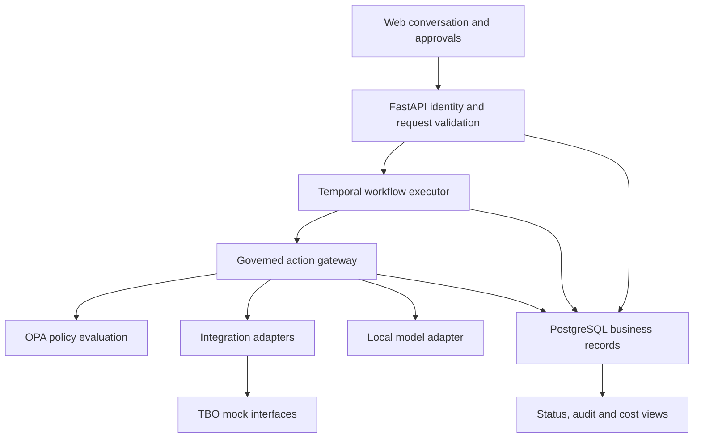

<!-- Verbatim copy of the Round 1 plan Codex produced in Plan mode (pasted by the user on 29 Oct 2026).
     Kept for reference. Where this file and handoff/CODEX_SUBMISSION_PLAYBOOK.md disagree, the playbook wins. -->

# RelayHR — HR platform and Round 1 submission plan

## 1. Summary and competitive approach

Prepare the complete Round 1 package: an editable submission deck, a six-page architecture document, a five-minute video script, and a detailed implementation blueprint.

Build the proposal around **onboarding after hiring and offer approval**, with **leave requests as the second workflow**. The team will use four to five developers, the existing RTX 5080 laptop, existing subscriptions, and approximately $30 of Cline credits. No additional purchases or paid hosting are required.

The HR brief awards 40% to governance and extensibility, 20% to automation, 15% each to cost and engineering, and 10% to experience. Every major feature must produce evidence against those criteria.

Requirements baseline: :codex-file-citation{path="C:/Users/yashc/Downloads/6adb42d2626d7_problem_statement/Problem Statement/Zendesk-Darwin box Automation.pdf" purpose="source"}

**Positioning:** RelayHR completes approved HR work across departments and shows the evidence behind every outcome.

Current products already describe HR agents, governance, integrations, and decision receipts. Our competitive case will therefore rest on observable engineering: fault recovery, enforced approvals, policy-change previews, measured local inference, and a live extension added without changing the engine. This is our proposed differentiation, not a claim that these capabilities are unprecedented. [Darwinbox Cortex](https://newsroom.darwinbox.com/darwinbox-launches-cortex-ai-native-hcm-platform), [Workday ASOR](https://community-content.workday.com/en-us/public/learn/resources/workday-ai-agents/agent-system-of-record-asor.html).

The four demonstrations that anchor the entry are:

- **Verified completion:** integrations must confirm the required outcome before the workflow closes.
- **Safe recovery:** a laptop allocation succeeds, its response disappears, and recovery still produces exactly one allocation.
- **Governed change:** HR previews how a proposed policy affects recorded cases before activating it.
- **Practical extension:** a developer adds leave through the documented extension model while retaining shared controls.

## 2. Product behavior

### Onboarding journey

The workflow begins with an approved hire. Hiring decisions, offer approval, and compensation remain human decisions.

| Stage | Platform behavior | Completion evidence |
|---|---|---|
| Intake | HR requests onboarding through chat; the system resolves the employee and confirms interpreted details | Authorized request with stable identifier |
| Prerequisites | Validate hire approval, manager, department, joining date, and required fields | Validation results and source references |
| Equipment | Allocate a standard device within approved policy | Confirmed allocation and asset reference |
| Accounts | Prepare directory and email accounts with permitted access | External account identifiers and observed status |
| Building access | Arrange the appropriate access card | Confirmed card status |
| Payroll preparation | Send validated setup information through the mock interface | Setup receipt; payroll execution remains separate |
| Manager readiness | Obtain the configured manager confirmation and handle exceptions | Named human decision where required |
| Completion | Verify mandatory outcomes, update lifecycle status when applicable, and send the permitted summary | Reconciled outcomes and complete action history |

Independent provisioning steps run concurrently after prerequisites pass. Date-dependent activation uses durable timers.

An accepted ticket does not count as a completed resource. Where mocks expose asynchronous status, the adapter polls or consumes the supported callback until it confirms readiness.

Missing information produces a focused clarification. Conflicting records or uncertain external outcomes produce an exception containing the current step, evidence, attempted recovery, and the decision required.

### Leave extension

The second workflow introduces different business logic while reusing execution, permissions, approvals, and metrics.

- Employees request leave through chat.
- Code calculates working days using the applicable calendar and sample policy.
- The platform checks eligibility, balance, and overlapping requests.
- The configured named approver decides when policy requires approval.
- Database transactions prevent concurrent requests from overspending the balance.
- Denial or cancellation releases reservations. Successful approval updates the record and sends confirmation.

The extension consists of a workflow definition, leave capabilities, policy configuration, and tests. It must not require changes to the orchestration engine or a dedicated frontend implementation.

### User experience

Provide five connected views:

- **Employee workspace:** conversation, clarifications, confirmations, and request status.
- **Manager inbox:** assigned decisions with exact scope, supporting evidence, and approve/reject actions.
- **HR operations:** active workflows, exceptions, overdue work, and pause/resume controls.
- **Evidence and cost dashboard:** business outcomes, automation, elapsed time, escalations, and operating cost.
- **Developer workspace:** registered workflows, capability contracts, validation results, and extension examples.

All views enforce access on the server. Selecting a role in the interface cannot grant authority.

## 3. Implementation architecture

### Technology choices

| Component | Choice | Purpose |
|---|---|---|
| Frontend | Next.js, React, TypeScript | Conversation and operational views |
| API | FastAPI and Pydantic | Authentication, validation, typed contracts |
| Durable execution | Temporal Python SDK | Persisted progress, timers, retries, human waits |
| Business storage | PostgreSQL, SQLAlchemy, Alembic | Employee records, approvals, policies, receipts, metrics |
| Policy engine | Open Policy Agent | Testable authorization and reserved-decision rules |
| Local inference | Ollama with Qwen3.5 4B and 9B | Structured intake and factual summaries |
| Verification | pytest, OPA tests, Playwright | Domain, policy, integration, and user-journey checks |
| Local deployment | Docker Compose plus Windows-hosted inference | Reproducible operation on the existing laptop |

The laptop has approximately 16 GB VRAM and 32 GB system memory. Docker is installed but its engine was not running during inspection; environment setup is an early milestone.

Use Temporal's persistent local development server for the hackathon. Configure its state file explicitly because the default development mode loses executions when the server stops. This is a demonstration deployment, with a documented production migration path. [Temporal persistence](https://docs.temporal.io/cli/command-reference/server).

### Responsibilities and data flow

1. Authenticate the person and determine their permitted service actions.
2. Minimize the message and relevant context before model processing.
3. Convert conversation into a typed proposal.
4. Ask for clarification where required and show consequential request details for confirmation.
5. Persist the confirmed request and an execution-start event atomically.
6. Start the versioned workflow using a stable business identifier.
7. Route each action through the governed gateway.
8. Verify the external result and persist its receipt.
9. Update status and metrics from recorded events.

Use a database outbox for starting workflows and delivering approval events. Repeated delivery must remain safe.

PostgreSQL owns business records and human decisions. Temporal owns durable execution progress. The UI reads an idempotently updated projection of that progress.

### Minimum platform contracts

| Contract | Required information |
|---|---|
| Workflow definition | Identifier, version, input schema, dependency graph, capability references, and completion requirements |
| Capability registration | Input/output schemas, permissions, allowed tools, side-effect classification, and verification behavior |
| Integration adapter | Execute, reconcile, supported cancellation behavior, receipt format, and classified errors |
| Action receipt | Actor and delegation, input references, policy version, approval reference, model/prompt version when used, external outcome, timestamps, and cost attribution |

The registry validates definitions before activation: valid schemas, known capabilities, complete dependencies, no cycles, and applicable policies.

Extensions use trusted, reviewed code. Arbitrary code execution from chat is excluded.

### API behavior

Expose authenticated operations for:

- Conversational proposals and confirmed service requests.
- Workflow status and streamed progress.
- Human approval decisions.
- Pause, resume, cancellation, and exception resolution.
- Workflow registration and activation.
- Policy preview and activation.
- Audit and metric export.

Request creation and decision submission accept idempotency identifiers. Approval decisions bind to the exact action parameters being approved. Material changes invalidate earlier approval.

### Governance

Every data access, model call, and integration action passes the relevant policy check.

The gateway returns one of four outcomes: **allow, deny, require approval, or require clarification/intervention**. Missing rules and unavailable policy evaluation block execution.

Seed the complete reserved-decision list from the brief as governed configuration, including hiring, compensation, resignation terms, termination, disciplinary matters, role changes, policy exceptions, sensitive complaints, and statutory/payroll sign-off.

Additional controls:

- Agents inherit no more authority than the person they represent.
- Only an authenticated authorized human can submit a reserved decision.
- Sensitive complaints enter a restricted human queue.
- Workflow definitions remain versioned; each dispatch evaluates the active policy and records that version.
- HR can change policy configuration through a versioned approval process.
- Policy changes cannot silently authorize already changed action parameters.
- Pause blocks new dispatches after acknowledgment. In-flight operations remain visible and are reconciled.
- Audit records contain concise factual explanations and rule references, without depending on private model reasoning.

OPA supports policy tests and decision logging; sensitive inputs must also be masked in its logs. [Policy testing](https://www.openpolicyagent.org/docs/policy-testing), [decision-log masking](https://www.openpolicyagent.org/docs/management-decision-logs).

### Reliability

Persist each intended external operation before dispatch and reuse its identifier across attempts.

- Retry confirmed transient failures with bounded backoff.
- After a timeout with an uncertain result, reconcile before another write.
- Use external idempotency support where available.
- If the interface cannot establish whether the action happened, stop for human intervention.
- Preserve completed work when another department fails.
- Allow reversal only where the adapter supports it and policy permits it.

Temporal activities can execute again after a lost acknowledgment, so durable orchestration must be combined with adapter idempotency and reconciliation. [Temporal execution guidance](https://docs.temporal.io/develop/python/best-practices/error-handling).

### Models and privacy

Start with quantized **Qwen3.5 4B** for intent extraction and short summaries. Use **9B** for validated difficult cases. Both official model cards identify Apache 2.0 licensing. [4B model](https://huggingface.co/Qwen/Qwen3.5-4B), [9B model](https://huggingface.co/Qwen/Qwen3.5-9B).

- Use schema-constrained output, approximately 4K context, bounded output, and disabled thinking for routine extraction.
- Begin with one inference request at a time and one loaded model at a time.
- Benchmark accuracy, latency, and memory before increasing concurrency.
- Permit one larger-model fallback for failed validation or demonstrated complexity.
- Ask the user or escalate when uncertainty remains.
- Keep eligibility, dates, balances, routing, authorization, and state transitions in code.
- Use templates for routine status messages.
- Implement interchangeable Ollama and llama.cpp adapters; demonstrate a provider switch through configuration.

The model receives pseudonymous identifiers and the minimum fields required. Bank details, identification documents, and unnecessary salary information stay outside prompts. Runtime inference remains local.

Represent lifecycle records from hire to exit, while implementing onboarding and leave deeply. Record changes with actor, reason, and history.

Include purpose, retention, correction/access handling, and legal-rule provenance. Legal applicability and effective dates belong in an HR-approved rule register. The DPDP Rules have phased commencement, so the submission must describe implemented controls precisely rather than claim blanket certification. [Official DPDP Rules](https://www.meity.gov.in/static/uploads/2025/11/53450e6e5dc0bfa85ebd78686cadad39.pdf).

## 4. Build sequence and acceptance evidence

### Ownership and milestones

| Period | Work and exit condition |
|---|---|
| 28 October–3 November | Confirm portal requirements and starter-kit access; establish contracts; prove persistent execution, one policy gate, and local structured inference |
| 4–10 November | Complete one onboarding path, named approval, action receipts, and lost-response recovery |
| 11–16 November | Finalize concept package; rehearse the video; inspect every document page and slide |
| 17–25 November | Submission buffer, interface alignment, developer-guide draft, and extension rehearsal |
| 26 November–3 December | Complete onboarding across all required mock integrations and reconcile outcomes |
| 4–10 December | Add leave through the extension model; complete access, privacy, and policy-change controls |
| 11–17 December | Run the evaluation cohort, cost accounting, failure tests, and held-out model assessment |
| 18–23 December | Freeze features, rehearse demos, verify clean-machine setup, and prepare prototype evidence |

The current portal lists the prototype window as **26 November–24 December 2026** and the finale as **8 January 2027**. Recheck the live listing before submission. The concept package has an internal completion target of 16 November. [Event requirements](https://api.unstop.com/competitions/voyagehack-40-tbocom-1774031).

Assign ownership as follows:

- Developer 1: execution engine and state consistency.
- Developer 2: policies, permissions, approvals, and privacy.
- Developer 3: integrations, reconciliation, and fault injection.
- Developer 4: frontend and end-to-end user journeys.
- Developer 5: evaluation, local inference, cost accounting, and submission coordination.

With four developers, combine the fifth role with the coordinator and share its test work. Every critical subsystem receives a second-person review.

### Evidence required before prototype submission

| Area | Acceptance condition |
|---|---|
| Automation | At least 80% of predefined onboarding business steps complete without human touch in healthy scenarios |
| Approval enforcement | Every reserved-action test blocks execution until the correct human decision |
| Duplicate prevention | Zero duplicate resources across repeated-event and lost-response tests |
| Persistence | Restarting API, worker, or orchestration service preserves recoverable progress |
| Completion | No workflow closes with missing mandatory receipts or approvals |
| Access | Cross-employee, cross-team, and unauthorized approval attempts fail server-side |
| Policy changes | Changed rules govern subsequent dispatches; changed action scope requires fresh approval |
| Kill switch | No new operation is admitted after pause acknowledgment |
| Extension | A teammate adds a new supported workflow using the guide without core-engine edits |
| Model quality | At least 95% correct accepted intent/field extraction on the held-out set |
| Privacy | Prompt and log inspection confirms prohibited fields remain absent |

These are build targets, not current results.

Use approximately 240 labeled conversational cases split between development and held-out evaluation, plus at least 120 workflow executions covering healthy operation and injected failures. Derive final fixtures from the organizer's synthetic dataset.

Count stable business steps, rather than inflating automation through numerous trivial technical activities. Report planned human decisions separately from unexpected escalation.

### Cost accounting

Report:

- INR operating cost per completed workflow.
- Automated business-step share.
- Completion, failure, and pending counts.
- Median and p95 cycle time.
- Planned approval wait and unexpected escalation.
- Model usage, fallback frequency, and inference latency.

Calculate cohort cost per completion using **all attributable cohort operating costs**, including failed attempts and retries.

For the concept document, use an explicitly labeled illustrative calculation:

> Assuming 100 completions during two serving hours, 220 W whole-device power, ₹10/kWh electricity, and ₹8/hour hardware allocation, allocated operating cost is approximately ₹0.20 per completion.

Those are planning assumptions. Replace runtime and throughput assumptions with observed measurements during the build, and disclose which electricity and hardware rates remain allocated assumptions. Production projections use TBO-supplied transaction volumes and explicit infrastructure capacity.

Use the existing Cline credits provisionally as:

- $12 for difficult backend and recovery work.
- $8 for independent security and policy review.
- $5 for integration or evaluation debugging.
- $5 held for late blockers.

Track actual consumption and stop at the available balance. These are development credits, recorded separately from workflow operating cost. The runtime requires no Cline or subscription balance. [Cline billing model](https://docs.cline.bot/core-workflows/task-management).

## 5. Submission package

### Portal deck

Produce **three slides total: cover plus two content slides**, with editable PPTX and matching PDF. Omit a separate thank-you slide.

The portal explicitly allows two content slides excluding cover and thank-you slides, while the HR brief separately requests a six-page architecture document and five-minute video. Prepare both formats as distinct assets; upload according to the actual portal fields. [Portal submission format](https://api.unstop.com/competitions/voyagehack-40-tbocom-1774031).

| Slide | Content |
|---|---|
| Cover | RelayHR, AI Native HR Services Platform, VoyageHack 4.0 concept submission |
| 1 — Solution, innovation, impact | The coordination problem; onboarding journey; governed execution; verified outcomes; failure recovery; clearly labeled automation target |
| 2 — Architecture, feasibility, adoption | Editable architecture diagram; local models and deterministic rules; extension mechanism; cost assumptions; delivery milestones; gradual adoption and integration risks |

Use restrained navy, teal, and white styling, readable typography, and flat compositions. Architecture elements and tables remain editable. Cite researched claims in speaker notes and preserve visible qualifications on estimates.

No fabricated product screenshots, measured results, customer endorsements, or unsupported savings claims.

### Six-page architecture document

The page limit includes all content and references, with no separate cover.

1. **Problem and chosen service:** users, onboarding boundaries, outcomes, and differentiation.
2. **Architecture and records:** components, data flow, ownership, and lifecycle model.
3. **Governance and recovery:** reserved decisions, approvals, policy versions, privacy, pause behavior, and uncertain outcomes.
4. **Models and economics:** hardware, routing, evaluation method, estimated cost, and monthly projection formula.
5. **Extension model:** registration contracts and the leave example.
6. **Delivery and validation:** milestones, acceptance tests, adoption risks, assumptions, and compact references.

Deliver editable DOCX and submission PDF. Render and inspect every page.

### Five-minute video script

| Time | Story |
|---|---|
| 0:00–0:35 | HR coordination problem and intended outcome |
| 0:35–1:30 | Onboarding journey and cross-team completion |
| 1:30–2:20 | Named approvals, policy checks, and privacy |
| 2:20–3:05 | Lost-response recovery and duplicate prevention |
| 3:05–3:45 | Leave extension without engine changes |
| 3:45–4:30 | Local models, cost logic, and evaluation |
| 4:30–5:00 | Implementation milestones and adoption |

The concept video explains the design and labels any illustrative sequence. A later prototype recording demonstrates actual software and measured results. The immediate package includes the timed narration and storyboard; a script alone does not satisfy the required video upload.

### Implementation handoff

Deliver the full blueprint in Markdown and PDF, including:

- Architecture decisions and public contracts.
- Onboarding and leave sequences.
- Data ownership, state transitions, and approval behavior.
- Failure-recovery and reconciliation rules.
- Developer work packages and dependencies.
- Test matrix, benchmark procedure, and cost formulas.
- Live-demo sequence and extension rehearsal.
- Starter-kit compatibility checklist.
- License inventory and AI-assistance disclosure requirements.

Final submission gates are correct slide/page counts, complete rubric coverage, traceable claims, consistent estimates, readable rendering, and working deliverable files.

**Defaults and dependencies:** RelayHR is a working project name. The prototype is single-organization and runs locally. Web conversation is the primary channel. Final demonstrations use the supplied dataset and interfaces. Until that kit is available, adapter fixtures remain explicitly provisional. A full payroll engine, automated hiring decisions, and production HRMS migration fall outside the prototype.

Current work remains in Plan mode. The deck and document files have not yet been authored.
